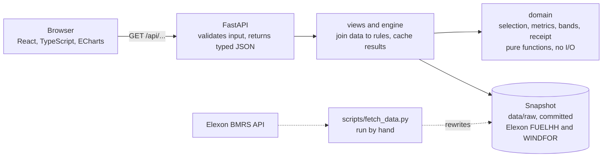

# GB day-ahead wind forecast portal

A web app for a GB energy buyer who has to commit to a day-ahead purchase each morning. It shows the latest national wind forecast that existed at the decision time, a range around it with suggested extra cover, and how accurate those forecasts were in January 2026. Data is Elexon BMRS only (FUELHH wind actuals, WINDFOR wind forecasts).

Live app: **TODO: paste the Vercel URL here after deploying** (steps below).

## How to run

With Docker (one command):

```bash
docker compose up --build
# open http://localhost:8000
```

Without Docker (Python 3.12 and Node 22):

```bash
pip install -r requirements-dev.txt
uvicorn backend.app.main:app --port 8000          # API and docs at http://localhost:8000/docs
cd frontend && npm ci && npm run dev               # UI at http://localhost:5173, proxies /api to port 8000
```

To serve the built UI from the API instead: `cd frontend && npm run build`, then start uvicorn as above and open port 8000.

Checks:

```bash
ruff check backend scripts tests api && mypy && pytest -q       # backend
cd frontend && npm run typecheck && npm test && npm run build   # frontend
```

## Files and directories

```
backend/app/
  main.py              FastAPI app, input validation, error handlers, static file serving
  models.py            Pydantic model for every response
  views.py             Builds each response from the engine
  engine.py            Joins the snapshot to the domain functions; caches per parameter set
  config.py            Paths, snapshot window, defaults, git commit
  domain/              Pure functions, no I/O
    selection.py       Picks the forecast row for a target (cutoff mode, lead-time mode, hindsight series), leakage guard
    metrics.py         MAE, RMSE, bias, WAPE, percentiles, buckets, histogram, error vs lead time
    bands.py           Walk-forward error bands, calibration, risk-ratio cover rule and its backtest
    quality.py         Data quality checks
    receipt.py         Canonical rows, SHA-256, receipt JSON and CSV
    timeutil.py        London cutoffs and delivery-day boundaries
  data/
    loader.py          Reads the committed snapshot
    elexon_client.py   Live Elexon client with retries, and the snapshot writer
data/raw/              Committed snapshot (gzipped JSON) and manifest.json
frontend/src/          Vite, React, TypeScript, TanStack Query, ECharts
  views/               Decision, Accuracy, Cutoff sensitivity, Data and method
  components/          Control bar, chart wrapper, timeline, tables
scripts/
  fetch_data.py        Refresh the snapshot from the live API
  verify_receipt.py    Recompute a decision receipt and check its hash
  make_fixture.py      Cut the test fixture from the snapshot
tests/                 pytest, with a 12-day fixture in tests/fixtures/raw
api/index.py           Vercel entry point (same FastAPI app)
docs/                  decisions, data notes, video scripts, run sheet, submission checklist
Dockerfile, docker-compose.yml, vercel.json, .github/workflows/ci.yml
```

## Architecture



How a request flows, in five steps:

1. The page asks for one delivery day and the settings (cutoff, cost ratio). The settings live in the URL, so any view can be shared as a link.
2. FastAPI checks the inputs and rejects bad ones with a plain message.
3. The engine picks, for each half-hour, the newest forecast published at or before the cutoff. A guard raises an error if a later forecast ever slips in.
4. Error bands and extra cover are built only from days that were fully finished before the decision time (walk-forward), so there is no peeking at the future.
5. The response goes back as typed JSON, and the page draws it. A receipt with a SHA-256 of the input rows lets anyone re-check the decision.

Why it is built this way:

| Choice | Reason |
|---|---|
| Data snapshot committed to the repo | The numbers reproduce exactly, with no API key and no rate limits. The running app never calls Elexon. |
| Domain code is pure functions | The leakage rule and the sign convention are tested in one place, with no network or files involved. |
| One FastAPI app serves the API and the built page | One deploy, one origin, no CORS surprises. The same app runs in Docker and as a Vercel function. |
| Results cached per setting | Moving between days and views is instant after the first load. |
| Receipt for every decision | A reviewer can verify which forecast rows were used without trusting the UI. |

## How forecast selection works

WINDFOR publishes a new forecast eight times a day (02:30, 04:30, 07:30, 09:30, 11:30, 15:30, 18:30 and 22:30, London time in January), each covering the next three days or so. A purchase for delivery day D+1 is made on day D before the auction closes. The forecast you can use is the one with the latest `publishTime` at or before that cutoff.

```
publish times on day D:   ... 04:30   07:30   09:30   11:30 ...
auction cutoff (09:20):                    |
                                  07:30 used   09:30 too late
```

For each half-hour T of delivery day D+1 and cutoff C (London time on day D), the app takes the row with the largest `publishTime` such that `publishTime <= C` and `startTime == T`. `select_forecast_at_cutoff` in `backend/app/domain/selection.py` is the only place this happens, and `enforce_publish_limit` raises if a row ever breaks the rule. A second mode, minimum lead time, picks `publishTime <= T - h` for a chosen h from 0 to 48 hours.

Cutoff assumption: the default is **09:20 London time**. EPEX SPOT moved the GB day-ahead auction from 11:00 to 09:20 GMT from 1 January 2021 ([EPEX](https://epexspot.com/en/news/exchange-council-welcomes-new-timing-gb-day-ahead-auction)). Nord Pool N2EX gives gate closure as 09:50 GMT ([Nord Pool](https://support.nordpoolgroup.com/support/solutions/articles/8000088463-about-the-day-ahead-gb-auction)). The cutoff is a parameter, and the sensitivity view runs 09:00, 09:20, 09:50, 11:00 and any time you add.

Decisions made in January 2026 are read as decision day D from 1 to 31 January, so delivery days are 2 January to 1 February. A switch in the control bar shows delivery days 1 to 31 January instead.

WINDFOR is hourly. By default the value at T is applied to both half-hours it covers. Linear interpolation is available. The value at `startTime` T is read as the hour starting at T, which the Elexon documentation does not state clearly.

## Metrics and sign convention

`error = forecast - actual`, in MW. Positive means over-forecast, which leaves the buyer short. Reported: MAE, RMSE, bias (mean error), WAPE (sum of absolute error over sum of actual), and the P50, P90 and P95 of absolute error, plus breakdowns by hour of day, forecast level (terciles), forecast age and day. Percentage error is not a headline because actual wind can be small. Errors are not divided by installed capacity, which is not in the allowed data.

Error bands and cover: for each decision day the app uses only delivery days whose actuals were complete (last period plus a 1 hour publication lag) before the decision time, needs at least 7 such days, and builds P10 to P90 bands from errors in the same forecast tercile (terciles from that history only). The cover for cost ratio r (cost of a shortfall over cost of a surplus) is the r/(1+r) quantile of the over-forecast error for that tercile, never below zero. A test checks that changing actuals on or after the decision day leaves every band unchanged.

## Assumptions and limits

- Actuals are metered output after curtailment, and FUELHH and WINDFOR may cover different sets of farms. Part of the error is therefore not forecast skill. The allowed data cannot separate it, and the 1.7 GW average over-forecast in January may be partly caused by it.
- Only January 2026 is covered, which is a windy winter month.
- No prices, demand, weather or capacity data. The cover backtest reports MWh, not pounds. The optional flat demand figure is the user's own input.
- Four cutoffs between 09:00 and 11:00 produce only two different selections here, because forecasts are issued at 07:30 and 09:30. The sensitivity view says so rather than showing four different answers.
- The error band is close to calibrated overall (79.8% inside against 80% nominal) but is poor in the mid-forecast tercile (63.8%) and on days when wind collapses, for example 28 January (0 of 48 half-hours inside).
- The Docker image was built and run in a restricted sandbox, not on a normal Docker host. The deployed Vercel app has not been loaded by me in a browser outside this environment: see the checklist.

## Data refresh and snapshot

The running app never calls Elexon. It reads `data/raw/*.json.gz`, described by `data/raw/manifest.json` (snapshot id, fetch time, request URLs, row counts, SHA-256 of the canonical rows). The snapshot id and fetch time show in the app footer and on every receipt.

```bash
python scripts/fetch_data.py     # pulls FUELHH and WINDFOR in weekly windows, retries, checks row counts, rewrites the snapshot
```

The script is repeatable: the same API data gives identical files and hashes. There is also `POST /api/admin/refresh`, which is off unless `ENABLE_ADMIN_REFRESH=1` and `ADMIN_TOKEN` are set. No API key is needed or stored.

## Decision receipt

Download JSON or CSV from the Data and method view or `GET /api/receipt?delivery_day=2026-01-15&cutoff=09:20&format=json`. It lists every half-hour with the selected `publishTime`, forecast and actual, plus the cutoff, decision timestamp, assumptions, snapshot id, fetch time, source URLs, git commit and the SHA-256 of the canonical rows.

```bash
python scripts/verify_receipt.py receipt_2026-01-15_0920.json
```

## Tests and CI

72 backend tests (selection table and property tests, metrics with hand-computed values, walk-forward leakage, receipt hash, API tests on a small fixture, pinned headline numbers on the real snapshot) and 14 front-end tests. GitHub Actions runs ruff, mypy, pytest, the front-end typecheck, tests and build, and a Docker build with a health check.

## Deployment

Vercel: the front end is built to static files and `api/index.py` serves the FastAPI app as a Python function reading the bundled snapshot. Dependencies unpack to about 115 MB, under the 250 MB function limit, and a cold start through all main endpoints took about 5 seconds when I timed it locally.

```bash
npm i -g vercel
vercel login
vercel --prod
```

Heroku works with the same Dockerfile (container stack): `heroku create`, `heroku stack:set container`, then `git push heroku main` with a `heroku.yml` that points `web` at the Dockerfile. I did not set that path up.

## AI tools used

I used Claude and Claude Code to scaffold the project, draft the backend, front end, tests, Docker and CI files, and the documents in `docs/`, and to run the data checks and test runs. **TODO (you): edit this paragraph to say what you wrote or changed yourself and what you reviewed.** All numbers in this repo come from runs on the committed snapshot.
